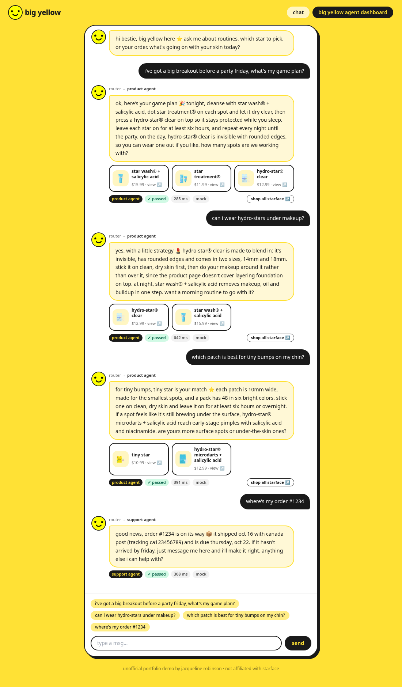
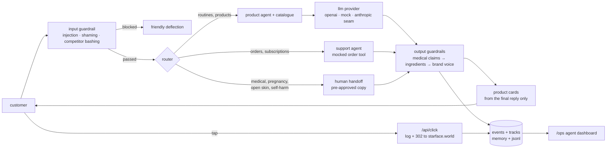

# big yellow · agentops

a starface customer chat agent that runs behind guardrails you can actually see, plus an agent dashboard that shows what it did, why, and whether customers clicked.
the model is the easy part; this demo is about the ops layer: routing, guardrails, evals, engagement and click-through, all observable.




## architecture



one request is one function, `handleMessage` in `src/lib/pipeline.ts`: check the input, route, draft, run the guardrail chain, attach product cards, and log everything, including the original draft, so the dashboard can show what the model *wanted* to say next to what the customer saw.

| piece | where |
| --- | --- |
| guardrails | `src/lib/guardrails/*` (one file per check, all pure functions) |
| router + agents | `src/lib/agents/*` (keyword router, order tool, escalation copy) |
| llm providers | `src/lib/llm/provider.ts` (`LlmProvider` interface: openai, mock, anthropic) |
| product cards + click guard | `src/lib/links.ts` (only `https://starface.world` urls are ever redirected to) |
| ops + engagement metrics | `src/lib/stats.ts` (pure, unit-tested) |
| demo traffic | `src/lib/simulate.ts` (8 scripted sessions + simulated clicks) |

## run it

```bash
npm install
npm run dev        # http://localhost:3000  (chat)  ·  /ops (agent dashboard)
npm test           # vitest: guardrails, router, conversations, tracking + stats
npm run build
npm run catalog    # refresh data/catalog.json from starface's public shopify feed
npm run redteam    # fire the 8 adversarial prompts at a running server
node scripts/screenshots.mjs   # retake screenshots/ (needs: npx playwright install chromium)
```

env vars (all optional, see `.env.example`):

| var | effect |
| --- | --- |
| `OPENAI_API_KEY` | private key|
| `OPENAI_MODEL` | defaults to `gpt-4o-mini` |
| `MOCK_LATENCY` | `0` skips the simulated mock latency |
| `LOG_JSONL` | `0` keeps logs in memory only (no `data/*.jsonl`) |


### the catalogue

`data/catalog.json` is fetched from `https://starface.world/products.json` (45 products: name, description, price, url, image). `keyIngredients` only lists an ingredient when its name appears verbatim in that product's own description; nothing is inferred.

### api

| route | does |
| --- | --- |
| `POST /api/chat` | `{ message, history, sessionId }` → full event (reply, verdict, checks, links) |
| `GET /api/events` | ops stats, engagement stats, last 60 events |
| `GET /api/click?eid&pid&kind&url` | logs a click, then 302s to the starface.world url (anything else goes to the homepage) |
| `POST /api/simulate` | 8 scripted customer sessions with simulated clicks (`source: simulated`) |
| `POST /api/redteam` | 8 adversarial prompts (`source: redteam`) |

## the agent dashboard (`/ops`)

- **guardrails + routing** (all traffic): pass / rewrite / block rates, blocked and rewritten reasons, routing split, escalations, p50 / p95 latency.
- **engagement + click-through** (chat + simulated; red team left out so it can't skew customer numbers): conversations, messages exchanged (user + agent), average messages per conversation, replies per agent, ctr overall, product-card ctr vs shop-all ctr, top products clicked.
- **recent events**: click any row for the draft vs final reply, every check with its reasons, and the links served. simulated rows carry a dashed violet `simulated` badge.

an impression is a card served with a reply; a click is a tap routed through `/api/click`.

## 60-second loom script

1. **(0–10s)** open `/`. "this is big yellow, starface's mascot, as a customer agent." tap *"i've got a big breakout before a party friday, what's my game plan?"*: a step-by-step plan, real product cards, badges for agent, guardrail result and latency.
2. **(10–22s)** ask *"will this cure my cystic acne?"*: the reply comes back **rewritten**, with no cure claim and a pointer to a dermatologist.
3. **(22–32s)** tap a product card: it opens starface.world in a new tab, and the click is logged on the way.
4. **(32–48s)** open `/ops`, hit **simulate traffic** and **run red team**. walk the cards: conversations, ctr by link type, top products. click the retinol row to show the draft vs final.
5. **(48–60s)** "every reply is checked, every click is measured, and the red-team set is a ready-made eval suite. that's the job i want."

## what i'd build next at starface

- **trend-listening agents** that read reviews, tiktok comments and support tickets overnight and file a morning brief: which stars people love, which claims customers keep asking for, which answers support keeps repeating.
- **inventory agents** that watch sell-through on limited drops (compacts, collabs) and draft restock or bundle suggestions for a human to approve.
- **evals in ci**: the red-team set and conversation tests become a scored suite on every prompt or model change, gating deploys on block rate, hallucination rate and brand-voice violations.
- **tracing** with opentelemetry or langfuse: router → retrieval → model → guardrail → click as spans, so a bad reply or a dead product card traces back to the exact prompt version and catalogue entry.
- **conversion attribution**: join `/api/click` sessions to shopify orders to report revenue per agent and per guardrail rewrite, not just ctr.

## known gaps

- order lookups, subscription details and delivery dates are demo data.
- ingredients come from description text, not shopify's full ingredient lists.
- the router is keyword-based; an llm or embedding classifier with a confidence threshold is the obvious next step.
- impressions are counted when a card is served, not when it scrolls into view.
